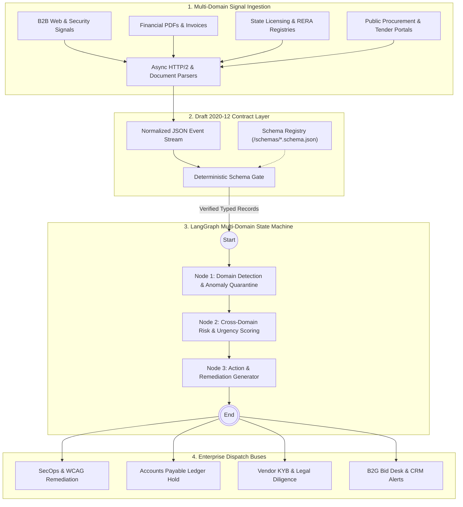
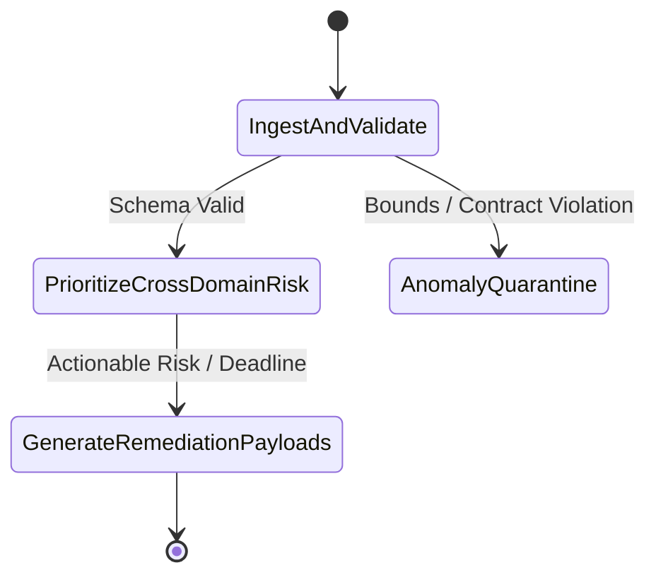

# Agentic Data Engine (`agentic-data-engine`)

[](https://www.python.org/downloads/)
[](https://github.com/langchain-ai/langgraph)
[](https://json-schema.org/)
[](LICENSE)

An enterprise reference architecture for **Autonomous Data Ingestion, JSON Schema Draft 2020-12 Normalization, and Multi-Domain LangGraph Reasoning Pipelines**.

This repository demonstrates how heterogeneous web, regulatory registry, public procurement, and financial PDF streams are validated against formal JSON Schema contracts and routed through deterministic **LangGraph** state machines into downstream ERP, KYB, SecOps, and Legal queues.

---

## System Architecture



---

## Repository Structure

```text
agentic-data-engine/
├── README.md                                        # Architecture & operational guide
├── requirements.txt                                 # Minimal runtime dependencies
├── schemas/                                         # Strict JSON Schema Draft 2020-12 contracts
│   ├── b2b_compliance.schema.json                   # Web WCAG 2.2, security headers & privacy audit
│   ├── financial_reconciliation.schema.json         # Multi-page PDF table & row-sum reconciliation
│   ├── us_contractor_license.schema.json            # Multi-state contractor KYB, bond & insurance
│   ├── public_procurement_tender.schema.json        # Public procurement tenders & urgency triage
│   └── real_estate_rera_compliance.schema.json      # Real estate regulatory filings & delay risk
└── agents/                                          # Autonomous LangGraph reasoning workflows
    ├── __init__.py
    ├── state.py                                     # TypedDict multi-domain pipeline state
    └── audit_agent.py                               # 5-domain validation, triage & dispatch graph
```

---

## Draft 2020-12 Data Contracts

Every record entering the reasoning graph is validated against one of five formal domain contracts:

| Domain | Schema Contract | Key Verified Signals | Downstream Dispatch Target |
| :--- | :--- | :--- | :--- |
| **B2B Web Compliance** | [`schemas/b2b_compliance.schema.json`](schemas/b2b_compliance.schema.json) | WCAG 2.2 alt/label deficits, HSTS/CSP headers, GDPR consent | `SECOPS_AND_WCAG_QUEUE` |
| **Financial Reconciliation** | [`schemas/financial_reconciliation.schema.json`](schemas/financial_reconciliation.schema.json) | Declared vs. calculated line-item totals, currency, math delta | `AP_LEDGER_HOLD_QUEUE` |
| **Contractor KYB Licensing** | [`schemas/us_contractor_license.schema.json`](schemas/us_contractor_license.schema.json) | Multi-state license standing, surety bond, liability insurance, expiry | `VENDOR_KYB_UNDERWRITING` |
| **Public Procurement** | [`schemas/public_procurement_tender.schema.json`](schemas/public_procurement_tender.schema.json) | Active tenders, corrigendums, sector classification, closing urgency | `B2G_BID_DESK_DISPATCH` |
| **Real Estate RERA Diligence** | [`schemas/real_estate_rera_compliance.schema.json`](schemas/real_estate_rera_compliance.schema.json) | Official RERA registration, promoter entity, GPS lat/lng, extensions | `LEGAL_COLLATERAL_DILIGENCE` |

---

## Autonomous LangGraph State Transitions



### Quickstart

```bash
# 1. Clone repository
git clone https://github.com/amanmishra22/agentic-data-engine.git
cd agentic-data-engine

# 2. Install dependencies
pip install -r requirements.txt

# 3. Execute the 5-domain triage state machine
python -m agents.audit_agent
```

### Sample Multi-Domain Dispatch Output

```json
[
  {
    "domain": "financial_reconciliation",
    "entityId": "https://docs.enterprise.example/invoices/inv-2026-884.pdf#page=1",
    "dispatchChannel": "AP_LEDGER_HOLD_QUEUE",
    "riskLevel": "CRITICAL",
    "urgency": "IMMEDIATE",
    "recommendedActions": [
      "Hold invoice payout: declared total (14850.0 USD) differs from line-item sum (14350.0 USD) by 500.0."
    ]
  },
  {
    "domain": "contractor_license",
    "entityId": "OR-198412",
    "dispatchChannel": "VENDOR_KYB_UNDERWRITING",
    "riskLevel": "CRITICAL",
    "urgency": "IMMEDIATE",
    "recommendedActions": [
      "Vendor 'APEX STRUCTURAL CONTRACTING LLC' triaged as REJECT; review flags: STATUS_EXPIRED, LICENSE_EXPIRED."
    ]
  }
]
```

---

## Engineering Principles

- **Zero-Trust Ingestion:** Malformed payloads and out-of-bounds scores are quarantined before reaching reasoning nodes.
- **Deterministic Financial & KYB Guardrails:** Arithmetic discrepancies, license expirations, and regulatory extensions are evaluated deterministically rather than delegated to probabilistic generation.
- **Idempotent Graph Nodes:** Each node operates purely on `PipelineState` transitions for reproducible audit trails.

---

## License

Released under the MIT License.
