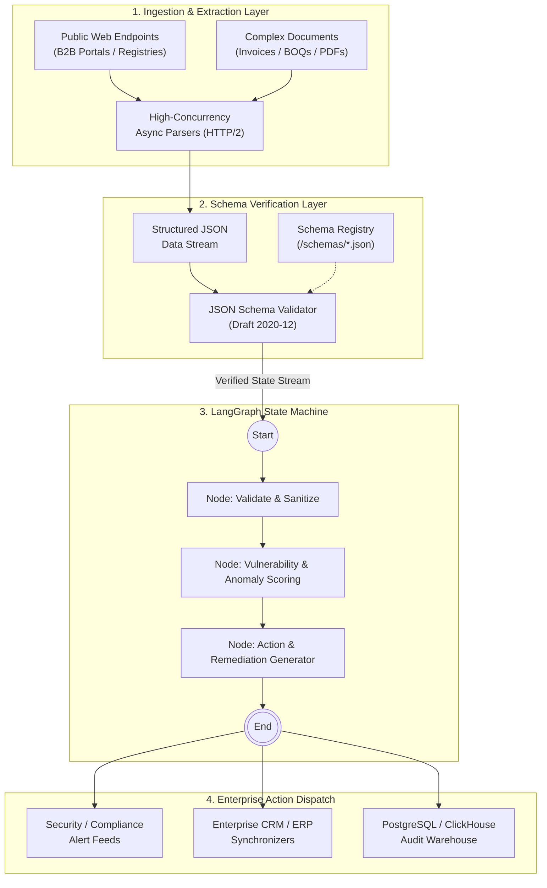
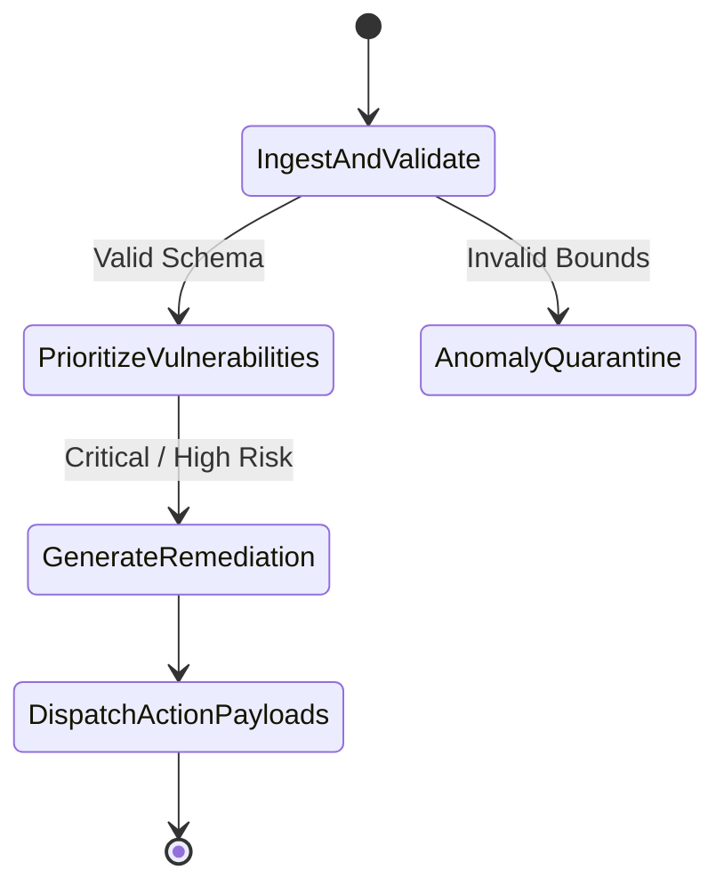

# Agentic Data Engine (`agentic-data-engine`)

[](https://www.python.org/downloads/)
[](https://github.com/langchain-ai/langgraph)
[](https://json-schema.org/)
[](LICENSE)

An enterprise-grade reference architecture for **Autonomous Ingestion, Schema Normalization, and Multi-Agent Reasoning Pipelines**.

This repository demonstrates how high-throughput, raw web & document signals are ingested, verified against formal JSON schemas, and dispatched through state-machine reasoning agents built with **LangGraph**.

---

## 🏛️ System Architecture



---

## 📂 Repository Structure

```
agentic-data-engine/
├── README.md                           # System architecture & documentation
├── requirements.txt                    # Minimal dependencies
├── schemas/                            # Strict, vendor-neutral JSON Schemas
│   ├── b2b_compliance.schema.json      # Web accessibility, security & privacy schema
│   └── financial_reconciliation.schema.json # PDF table extraction & balance reconciliation
└── agents/                             # Autonomous reasoning state machines
    ├── __init__.py
    ├── state.py                        # TypedDict pipeline state definitions
    └── audit_agent.py                  # LangGraph multi-node remediation workflow
```

---

## 🔍 Data Schemas

The engine enforces strict, typed contracts before data reaches the reasoning layer:

| Schema | File | Primary Use Case |
| :--- | :--- | :--- |
| **B2B Compliance Feed** | [`schemas/b2b_compliance.schema.json`](schemas/b2b_compliance.schema.json) | WCAG 2.2 accessibility failures, HSTS/CSP security header gaps, cookie consent status. |
| **Financial Reconciliation** | [`schemas/financial_reconciliation.schema.json`](schemas/financial_reconciliation.schema.json) | Multi-page PDF financial tables, balance reconciliation delta, tax breakdown. |

---

## 🤖 Autonomous LangGraph Agent Workflow

The agent uses a **StateGraph** to progress from raw data to an actionable executive plan without human intervention:



### Running the Demo Agent Locally

```bash
# 1. Clone repository
git clone https://github.com/amanmishra22/agentic-data-engine.git
cd agentic-data-engine

# 2. Install dependencies
pip install -r requirements.txt

# 3. Execute the state graph agent
python -m agents.audit_agent
```

### Sample Output

```json
{
  "targetUrl": "https://vulnerable-portal.org",
  "riskLevel": "CRITICAL",
  "urgency": "IMMEDIATE",
  "contactRecipients": ["contact@vulnerable-portal.org"],
  "recommendedRemediation": [
    "Configure Strict-Transport-Security header (max-age=31536000; includeSubDomains).",
    "Define Content-Security-Policy to mitigate Cross-Site Scripting (XSS).",
    "Add descriptive alt attributes to 18 unlabelled visual assets."
  ]
}
```

---

## 🛡️ Production Engineering Standards

- **Zero-Trust Input:** All incoming records must pass schema validation prior to memory buffer insertion.
- **Deterministic Routing:** Conditional branches safely isolate anomalous records to prevent LLM hallucinations.
- **Stateless Execution:** Nodes are idempotent and state transitions are auditable across time.

---

## 📄 License
This project is licensed under the MIT License — see the LICENSE file for details.
